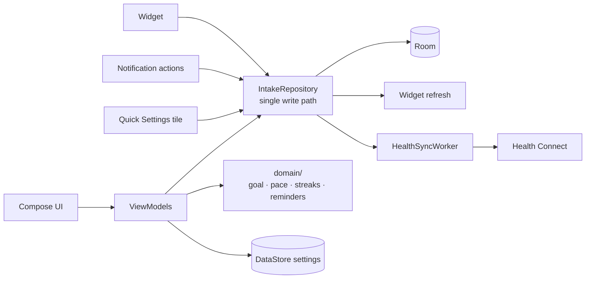

<!-- DRAFT: replaces README.md when v2 merges into main. Swap the screenshot placeholders for real captures. -->

<div align="center">


# HydroTrack

**A private, offline water tracker for Android.**
No accounts. No ads. No analytics. Your data never leaves your phone.

[](https://github.com/arunkmr13/HydroTracker/actions/workflows/ci.yml)
[](https://github.com/arunkmr13/HydroTracker/releases/latest)
[](LICENSE)


[Download APK](https://github.com/arunkmr13/HydroTracker/releases/latest) ·
[Report a bug](https://github.com/arunkmr13/HydroTracker/issues/new/choose) ·
[Changelog](CHANGELOG.md)

</div>

---

## Screenshots

| Today | Log a drink | History | Insights |
|:---:|:---:|:---:|:---:|
|  |  |  |  |

| Widgets | Dark theme |
|:---:|:---:|
|  |  |

## Why HydroTrack

- **Tells you what to do next.** Not just a percentage: *"Have 250 ml by 3 PM"*, with a marker on the
  ring showing where you should be by now.
- **Logs in one tap.** Your own named drinks (*Glass 250 · Office mug 300 · My bottle 850*) from the
  app, the widget, the notification or a Quick Settings tile.
- **Reminds you only when you're behind.** Smart reminders follow your pace and stay quiet outside
  your waking hours.
- **Private by design.** Everything is stored on the device.

## Features

- [x] Weight-based daily goal (35 ml/kg) with manual override
- [x] Named drinks with portions (full, ¾, ½, ¼) and drink types: water, tea, coffee, juice, milk
- [x] Log for now or for earlier (30 min, 1 h, or pick a time)
- [x] Today: progress ring, pace marker and a single next step
- [x] History: 14-day trend, 7-day bars, month calendar with day details and editing
- [x] Weekly insights: days on target, weakest time of day, drink mix
- [x] Optional evening check-in
- [x] Smart reminders, bedtime check and a weekly review
- [x] Home screen widgets (small, large), notification actions, Quick Settings tile, launcher shortcuts
- [x] Material 3 with dynamic colour, light and dark
- [x] Optional **Health Connect** sync (write-only hydration records)
- [ ] F-Droid release

## Privacy

| | |
|---|---|
| Accounts | None |
| Network access | None |
| Analytics or crash reporting | None |
| Where data lives | On-device Room database |
| Health Connect | Off by default. When on, HydroTrack only **writes** hydration records and never reads your other health data. |

Uninstalling the app removes all of its data.

## Install

**GitHub Releases:** download the latest signed `HydroTrack-vX.Y.Z.apk` from
[Releases](https://github.com/arunkmr13/HydroTracker/releases/latest). Each release includes a
SHA-256 checksum.

**Obtainium:** add `https://github.com/arunkmr13/HydroTracker` to get updates automatically.

Requires Android 8.0 (API 26) or newer. Health Connect sync needs Android 14+, or the Health Connect
app on older versions.

## Architecture



- Every write (app, widget, notification) goes through `IntakeRepository`, so the widget and
  Health Connect never drift.
- Business rules live in a pure-Kotlin `domain/` package with JVM unit tests.
- Each entry stores the local day it was logged, so totals are correct across time zones and DST.

**Stack:** Kotlin · Jetpack Compose · Material 3 · Room · DataStore · WorkManager · Glance ·
Health Connect

## Build from source

```bash
git clone https://github.com/arunkmr13/HydroTracker.git
cd HydroTracker
./gradlew assembleDebug
```

See [DEVELOPMENT.md](DEVELOPMENT.md) for tests, database migrations and the release process.

## Contributing

Issues and pull requests are welcome. Please read [CONTRIBUTING.md](CONTRIBUTING.md) first.
Report security issues privately as described in [SECURITY.md](SECURITY.md).

## License

[MIT](LICENSE) © Arun Kumar
